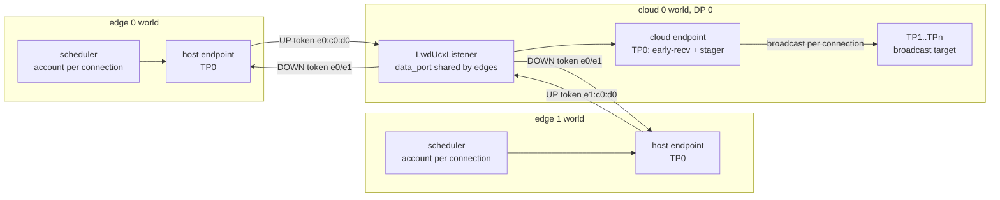

# 多边多云 Host 数据面设计

> **评审请求**：批准在 `data_plane_comm: host` 下支持 `cloud_share`、`lwd_cluster`、`edge_share` 的多边/多云连接模型。
> **改动面**：`vllm-ascend/.../host/lwd_host_channels.py`（D1，实现 +20/−6、单测 +157）与 `.../host/lwd_host_transfer_queue.py`（+13/−2），`vllm/distributed/lwd/lwd_parallel_groups.py`（D5，实现 +12/−4、单测 +69/−3），代码与测试共 5 个文件；另有本设计文档与 `lwd_host_data_plane.md` 的修正。D2 已由主线 `24c13841de` 实现，本系列不重复。
> **主要风险**：所有 edge 的 host IO 汇聚到 cloud DP 的 TP0；host 内存随 edge 数线性增长，但 12 GiB 固定预算覆盖当前规格。
> **怎么验**：2E1C、1E2C、cloud TP4 真机，加重复 bind / 缺边 / 错 token / 断链故障注入。
> **未决**：0 项（Q1–Q3 已定，见 §5.2）。
>
> 状态：已实现（PR 待创建）｜基线：vllm `fa61204aa6`、vllm-ascend `80098ef07a`（`vllm-data-comm/main`，已含云复用）｜参考：23.0 `host_rdma`（vllm `0473c7c645`，vllm-ascend `154cb355`）

## 1 背景

### 1.1 现状

当前 `data_plane_comm: host` 的代码形状仍是单 edge 对单 cloud DP：**第二个 edge 连到同一个 cloud DP 时，cloud 侧会在同一 `data_port` 上再次构造 `LwdUcxListener`**，按代码路径会在 bind 处失败或 listener 被覆盖。直接后果是 `cloud_share` 场景无法按当前实现启动；该结论来自静态路径分析，2E1C 真机复现步骤见 §4.2。

具体事实：

1. **拓扑层已经允许多边/多云。**
   - `LwdTopology._validate_host_layout` 只检查 host 模式不允许的 ranks、`hccl_world_size`、edge `data_port`，以及同地址下 `data_port` 不重复（`vllm/config/lwd/topology.py:373-411`）。
   - `cloud_share` 要求至少两个 edge、一个 cloud；`lwd_cluster` 要求至少两个 cloud（`vllm/config/lwd/topology.py:484-486`）。
   - `LwdTopology.connections()` 按 `instance_links` 逐 edge/cloud/DP 展开，天然返回多条连接（`vllm/config/lwd/topology.py:522-544`）。

2. **host 文档与实现不一致。**
   - 文档说“cloud DP 绑定一个共享 listener”，且 endpoint 是 DP 内 TP0（`docs/design/lwd_host_data_plane.md:57-59`）。
   - 文档又把“多个 edge 共享一个 cloud DP”列为 out of scope，并声称当前校验会拒绝（`docs/design/lwd_host_data_plane.md:158`）。实际上 `_validate_host_layout` 不拒绝，代码也没有拒绝，而是在初始化时踩到重复 bind。

3. **listener 的实际创建粒度和注释不一致。**
   - `lwd_init_host_channels` 对 `endpoint_conns` 逐条连接循环；每条 cloud 连接都执行 `listener = LwdUcxListener(addr, port)`，然后写入同一个 `(cloud_id, dp_idx)` 键（`vllm_ascend/distributed/lwd_data_plane/host/lwd_host_channels.py:263-282`）。
   - `LwdUcxListener.__init__` 里直接 `bind + listen`（`vllm/v1/lwd_comm/data_comm/ucx_channel.py:1656-1673`）。同一 cloud DP 的第二条连接会再次 bind 同一地址/端口。

4. **cloud 侧 TP rank 映射曾为空，已由基线修复。**
   - 旧 host 分支把 `_lwd_up_src_ranks` 设为 `{}`；cloud runner 在第一个 prefill 窗口无条件索引它（`worker._lwd_up_src_ranks[connection]`，既用于判断 endpoint，也用于 `dist.broadcast(src=...)`，`vllm_ascend/worker/lwd_cloud_model/lwd_cloud_model_runner.py:707-724`），因此 host 模式首个 prefill 会 `KeyError`；这与 TP 大小无关，单 edge 也受影响。
   - 基线重建后该映射由 `24c13841de` 填成该 DP 的 TP0 rank（`lwd_cloud_worker.py:94-110`）。本系列只覆盖 D1/D5，不再重复 D2，但仍以 G3 回归它。

5. **多连接的基础设施已经存在，不应推倒重来。**
   - `LwdDataPlane` 的队列键已经是 `(request.connection, channel, op)`（`vllm_ascend/distributed/lwd_data_plane/lwd_data_plane.py:177-180`）。
   - host queue 的 IO 查找需要按 `(edge_id, cloud_id, dp_idx, channel, op)` 解析：本系列把 `lwd_get_host_io` 的调用改为传完整 `connection`；当前主线仍传裸 `dp_idx`，一个进程持有多个 `(edge, cloud)` 对时会触发 ambiguous 保护（见 D1 附带的队列修正）。
   - 控制面按 `ConnectionId` 建连，cloud/edge 两侧都逐连接握手（`vllm/v1/lwd_control/lwd_comm/lwd_control_plane.py:618-650`）。
   - edge scheduler 按 connections 逐连接建 account（`vllm/v1/lwd_control/control_edge_scheduler/lwd_edge_scheduler.py:127-132`）。
   - cloud engine 逐连接建 hint/done MQ（`vllm/v1/lwd_control/control_cloud_scheduler/lwd_cloud_engine.py:144-169`）。

6. **host 内存按连接线性增长，但 12 GiB 固定预算覆盖当前规格。**
   - `BLOCKS_PER_CHANNEL = 4`（`vllm_ascend/distributed/lwd_data_plane/host/ucx_io.py:58`）。
   - 每个连接 UP/DOWN 各一个池，需要 `4 × (up_buffer_size + down_buffer_size)` MiB。
   - 当前预算固定为 `12 GiB`（`vllm_ascend/distributed/lwd_data_plane/host/lwd_host_channels.py:194`），按 `links = 2 × endpoint_conns` 计算（同文件 `:239-247`）。
   - 以 `up=128 MiB, down=32 MiB` 为例，每条连接约 `640 MiB`；当前多边多云规格的 edge/cloud 上限下总需求低于 12 GiB。超出规格时仍应在启动期 fail fast，而不是依赖运行期 OOM；本期不新增预算配置。

### 1.2 痛点与量化

| 痛点 | 现象 | 量级 |
| --- | --- | --- |
| 多 edge 共享 cloud DP 不可用 | 按代码路径，第二个 edge 连入时 cloud 重复 bind 同一 `data_port`，启动失败或 listener 路由被覆盖 | 2E1C 代码路径即可触发（待真机复现） |
| host 首请求不可用 | `_lwd_up_src_ranks` 为空，cloud runner 索引即 `KeyError` | 已由基线 `24c13841de` 修复；本系列按 G3 回归 |
| edge 多 TP 静默半残 | 只有 TP0 建 host 链路（`lwd_host_channels.py:242`），其他 TP rank 没有 IO，但没有启动校验 | edge TP>1 时可能提交到无 IO 的 rank |
| 多边 hint 串行 | 一个 early-recv 线程按连接顺序逐条 `dequeue`（`lwd_cloud_worker.py:337-360`） | E 条边时最坏轮询延迟约 E×timeout；正确性不受影响，但 tail latency 随 E 增长 |

### 1.3 为什么现在做

多边多云分支已经合入 host 数据面，下一步要单独向 `vllm-data-comm/main` 提 PR。如果继续只按 1E1C 交付，`cloud_share` / `lwd_cluster` 的拓扑能通过校验但在启动或首请求失败，等于把问题留给部署阶段。23.0 `host_rdma` 已经证明“一个 cloud engine 共享 listener + 多 edge token 路由”是可行形态，本设计要把这个不变量移植到当前无全局 rank 的模型上。

可复用的不变量（`host_rdma` 分支，仅作行为参照，不照搬其全局 rank registry）：

- 一个 cloud engine 一个 listener，token 含 `edge_id` 路由多 edge（`host_rdma:vllm_ascend/distributed/lwd_wire_host.py:415-419`）。
- host split-world 的 edge world 只有一个 rank，cloud 侧由 rank 0 承担 host 端点。
- host 内存按 `channels=2*E` 线性外推（`host_rdma:vllm_ascend/distributed/lwd_wire_host.py:194`）。

## 2 目标

### 2.1 一句话目标

把 host 数据面的 listener 从“每条连接一个”改为“每个 cloud DP 一个共享 listener”，并在启动期拒绝 edge TP>1；cloud TP0 endpoint 的 rank 映射由基线 `24c13841de` 提供，本系列依赖它，使 2E1C、1E2C 和 cloud TP4 能启动并正确处理请求。

### 2.2 可验收判据

- **G1（cloud_share）**：2E1C、D=1 的 `cloud_share` 启动成功；cloud 日志只有一次 `listener ready`，`ios` 同时包含 `e0c0/0` 与 `e1c0/0` 的 UP/DOWN；两个 edge 各自首个请求成功，cloud 侧有 2 组 hint/done MQ。
- **G2（lwd_cluster）**：1E2C、D=1 的 `lwd_cluster` 启动成功；edge 日志包含 2 个 cloud 的 4 条连接 IO；两个 cloud 各自收到请求，DOWN 结果回到正确 edge。
- **G3（cloud TP，基线 `24c13841de` 已实现，本系列回归）**：cloud TP=4、D=1 时，`_lwd_up_src_ranks` 对每条连接都等于该 DP 的 TP0 全局 rank；首个 prefill 不出现 `KeyError`；TP0 staging 后 broadcast 到 TP1-3，输出与 device 数据面基线一致。
- **G4（内存边界）**：当前规格内（以 2E2C 为代表，`up_buffer_size=128`/`down_buffer_size=32`）`need_mb` 日志正确且低于 12 GiB；超出规格（如 E=20）时启动失败并打印 `need/limit/links`，不依赖运行期 OOM；本期不新增预算配置。
- **G5（回归）**：host 1E1C 与 `data_plane_comm: device` 的现有测试不退化；host 配置省略新字段时仍使用默认值。

### 2.3 非目标

- **edge TP>1**：本期不做。host 链路只在 edge TP0 建立，edge 侧没有把 TP 分片聚合后再发送的路径；23.0 的 host split-world 也要求 edge world 只有一个 rank。启动时 fail fast，而不是静默半残。
- **cloud endpoint 在 TP rank 间轮转**：本期固定 TP0。轮转需要 listener/控制面握手按 edge 重新分配 endpoint，收益是分摊 TP0 的 host IO，但复杂度高；放到后续性能 PR。
- **peer 重启恢复、seqno replay、动态 link 重规划**：沿用当前 failure model，链路失败以连接为单位失败，不自动重连。
- **修改 UHC1 帧格式、token 算法或握手协议**：token 已经包含 `edge/cloud/dp/channel`，多边多云不需要改 wire protocol。
- **跨 cloud 的请求迁移/负载再平衡**：属于多边调度策略，不在数据面 PR。

## 3 设计

### 3.1 总体方案



一句话：**edge scheduler 按 `LwdConnectionId(edge, cloud, dp)` 产生/消费传输；每个 cloud DP 只保留一个 listener，按 token 把 E 条 edge 的 UP/DOWN 路由到各自 channel；cloud DP 的 TP0 负责所有连接的 host IO，再按连接把 prompt 窗口广播到本 DP 的 TP 组。** 图中 listener 只负责 accept/token 路由，DOWN 数据仍走已建立的同一条 UHC1 channel，不经过 listener 转发。

组件分工：

| 层 | 多边多云行为 |
| --- | --- |
| 拓扑 | `connections()` 展开 E×C×D；host 模式不填 ranks；cloud DP 必须有唯一 `data_port` |
| 控制面 | 每条 `ConnectionId` 独立握手；cloud 逐 edge 注册，edge 等待自己配置的所有 cloud |
| host link | 每个 cloud DP 一个 listener；每条连接 UP/DOWN 两个 UHC1 channel；token 含 edge/cloud/dp |
| 数据面 | 队列/seqno/future 以 `ConnectionId` 为键；host queue 按 connection 查 IO |
| cloud worker | TP0 endpoint 拥有本地所有 connection 的 stager/hint MQ；其他 TP rank 不持有 host link，只接收 broadcast 后参与本 DP 计算 |
| 调度 | edge 每连接一个 account；cloud 每连接一个 hint/done MQ；DOWN carrier 按 connection 归并 |

### 3.2 关键决策

#### D1 每个 cloud DP 一个共享 listener，而不是每条连接一个

- **问题**：当前逐连接创建 listener，2E1C 时第二个 edge 会在同一 `(addr, data_port)` 上再次 bind；`LwdUcxListener` 构造即 bind，第二个 listener 失败或覆盖第一个，cloud DP 无法服务两条 edge。
- **方案**：
    - 在 `lwd_init_host_channels` 中按 `(cloud_id, dp_idx)` 复用 `_UCX_LISTENERS` 已建的 listener：第一次遇到某个 cloud DP 时构造 `LwdUcxListener`，后续同 DP 的连接直接取用；
    - 所有 channel 先 `register`，再统一 `listener.start()`；
    - sidecar 模式保持 listener 由 transport daemon 按 `(host, port)` 共享，engine 侧不创建。
- **为什么可行**：UHC1 的 listener 只负责 accept + token 路由，数据通道各自有 UCP endpoint；token 已经是 `blake2b("edge_id:cloud_id:dp_idx:channel")`，不同 edge 的 token 天然不同（`lwd_host_channels.py:90-99`）。因此一个 accept 入口可以安全服务 E 条 edge。
- **否决的备选**：每条 edge 一个 `data_port` / 一个 listener。否决原因：拓扑的 `data_port` 是 cloud DP 级字段，不是 edge 级；E 条 edge 需要 E 个端口和 E 份端口规划，且 edge 侧要额外知道“自己是第几个 edge 用哪个端口”，与当前 `connections()` 的无状态展开冲突。23.0 的 `lwd_wire_host.py:415-419` 也是按 `(cloud_id, engine_index)` 建一个 listener，而不是按 edge。

#### D2 cloud host endpoint 的全局 rank 映射必须显式建立

- **状态**：已由基线 `24c13841de`（re-land）实现，本节保留设计理由与否决记录；本系列不重复提交，只按 G3 回归。
- **问题**：host 分支把 `_lwd_up_src_ranks` 设为空；cloud runner 在 `lwd_cloud_model_runner.py:710` 和 `:723` 无条件索引，host 模式首个 prefill 就 `KeyError`。
- **方案**：
    - 在 `LwdCloudWorker.__init__` 的 host 分支，用本 DP 的 TP 组首 rank 作为 endpoint：`endpoint_rank = get_tp_group().ranks[0]`（或等价的 `dist.get_rank() - get_tensor_model_parallel_rank()`）；
    - 对 `self._lwd_connections` 中每条连接写入 `self._lwd_up_src_ranks[connection] = endpoint_rank`；
    - `_lwd_early_recv_connections` 仍然只在 `get_tensor_model_parallel_rank() == 0` 时非空；
    - cloud runner 继续用这个映射判断 `connection_endpoint`，并用它作为 `dist.broadcast(src=...)` 的源 rank。
- **为什么可行**：host 模式没有 LWD 全局 rank，但每个 instance 自己的 TP 组有本 world 内的全局 rank；`dist.broadcast` 需要的就是这个 rank。TP0 是 host link 的唯一 owner，broadcast 源与 link owner 一致，不需要跨 world 的 rank 表。
- **否决的备选**：在 runner 里特判 `is_host_comm`，用 `get_tensor_model_parallel_rank()==0` 代替映射。否决原因：`connection_endpoint` 需要 global rank 做 broadcast source，local TP rank 不够；而且会把 host 特判散落到 runner，容易再次出现 device/host 两套逻辑。

#### D3 所有多连接状态继续以 `ConnectionId` 为键

- **问题**：多边/多云下，仅按 `edge_id` 或 `(edge_id, cloud_id)` 键控会让同一 edge 到多个 cloud、同一 cloud 的多个 DP 的 seqno 流互相污染。
- **方案**：不新增键类型；listener token、`_UCX_IOS`、`LwdDataPlane._queues`、hint/done MQ、DOWN carrier、edge account 全部继续使用 `(edge_id, cloud_id, dp_idx)`。
- **为什么可行**：seqno 是每连接单调的；`LwdConnectionId` 已经贯穿控制面、调度器和数据面（`vllm/config/lwd/topology.py:246-266`）。多边多云只是增加 key 的数量，不改变 key 的语义。
- **否决的备选**：按 `(edge_id, cloud_id)` 合并 DP；或按 `edge_id` 合并 cloud。否决原因：DP 是独立 engine，seqno 从 0 开始；合并会让不同 DP 的 seqno 冲突。多 cloud 共用 edge 时，edge 只有 edge_id 也无法区分 cloud。

#### D4 host 内存预算保持固定 12 GiB，不新增配置

- **问题**：多边场景下内存需求随本地连接数线性增长；如果每增加一种规格就扩一个配置项，会把本可由规格约束住的容量问题变成运维配置问题。
- **方案**：
    - 保留现有 `_HOST_MEM_BUDGET_MB = 12 GiB`（`lwd_host_channels.py:194`），不新增 `host_memory_budget_mb`；
    - 计算保持不变：`pools = 2 × E_local`，`need_mb = E_local × BLOCKS_PER_CHANNEL × (up + down)`，启动日志打印 `links/pools/need/limit`；
    - 超限时 fail fast；错误信息包含本地连接数、block 大小和当前上限，提示“超出当前多边多云规格”；
    - 当前规格（以 2E2C 为代表）的 `need_mb` 低于 12 GiB，作为设计约束写入文档和部署检查。
- **为什么可行**：每个连接两个池，池大小由 block 数和 block 大小唯一决定（`lwd_host_channels.py:197-207`）；当前规格的连接数乘 `4 × (up + down)` 远低于 12 GiB。固定上限能在启动期挡住规格膨胀，避免把 OOM 推迟到运行期，同时不扩大配置面。
- **否决的备选**：
    - 新增 `host_memory_budget_mb`：当前规格不需要，增加配置和回滚兼容面；未来规格扩大再单独评审；
    - 去掉上限、依赖 cgroup/OOM：会把失败点推迟到运行期，且 OOM 会拖垮整个 cloud engine；
    - 多条连接共享一个池：会引入跨连接的 head-of-line blocking 和 seqno 相互等待，破坏当前“每连接独立反压”的性质。

#### D5 host 模式显式拒绝 edge TP>1

- **问题**：host 链路只在 `tp_rank == 0` 创建（`lwd_host_channels.py:242`）；edge TP>1 时其他 TP rank 没有 host IO，但当前并行校验只检查 DP 数（`vllm/distributed/lwd/lwd_parallel_groups.py:198-215`），不会拒绝。
- **方案**：在 `lwd_check_parallel_config` 的 host 分支增加 `if lwd_config.role == "edge" and parallel_config.tensor_parallel_size > 1: raise ValueError(...)`；错误信息写清楚 host edge 只支持 `tensor_parallel_size=1`，建议 edge 侧不要开 TP。
- **为什么可行**：edge 的 UP 数据是 edge 层输出的完整 hidden；edge TP>1 时没有把 TP 分片聚合到 TP0 的路径，强行支持会发送不完整张量。23.0 的 host split-world 也明确要求 edge world 只有一个 rank。
- **否决的备选**：在 edge TP0 做 all-gather 后发送。否决原因：需要新增跨 TP 聚合和时序，超出本期“多边多云 host 数据面”的范围；先 fail fast，后续单独设计。

### 3.3 接口 / 数据 / 协议 / 配置变更

| 变更 | 位置 | 旧行为 | 新行为 | 兼容性 |
| --- | --- | --- | --- | --- |
| listener 生命周期 | `lwd_host_channels.py` | 每连接一个 listener | 每 `(cloud_id, dp_idx)` 一个 listener | 无 wire 变化；旧二进制不支持多 edge |
| host queue 链路解析 | `host/lwd_host_transfer_queue.py` | 按裸 `dp_idx` 查 IO（多连接下 ambiguous） | 按 `connection` 的 `(edge, cloud, dp)` 查 IO | 内部查找；token 不变 |
| cloud endpoint rank 映射 | `lwd_cloud_worker.py` | host 下为空 | 每连接指向本 DP 的 TP0 global rank | 已由基线 `24c13841de` 落地；内部字段，不影响 device 路径 |
| edge TP 校验 | `vllm/distributed/lwd/lwd_parallel_groups.py` | 不检查 | host + edge TP>1 启动失败 | 旧 host edge TP>1 本来就不工作 |
| 文档 | `docs/design/lwd_host_data_plane.md` | 声称多 edge 被校验拒绝 | 改为“支持 cloud_share/lwd_cluster，约束见本文” | 仅文档 |
| UHC1 token/帧/握手 | `lwd_host_channels.py` / `ucx_channel.py` | 已含 edge/cloud/dp | 不变 | 同版本可互通 |
| `data_port` | `vllm/config/lwd/topology.py` | cloud DP 级，必须唯一 | 不变 | 多 cloud 仍按 DP 规划端口 |
| host 内存预算 | `lwd_host_channels.py` | 固定 12 GiB | 固定 12 GiB，不新增字段 | 无配置变更 |

不在本期变更：`LwdConnectionId` 结构、控制面消息、scheduler account 语义、device 数据面、`host_memory_budget_mb`。`lwd_cloud_model_runner.py` 不新增 host 特判；它继续消费 D2 修正后的 `_lwd_up_src_ranks`，由验收 G3 覆盖。

### 3.4 失败路径与降级

| 场景 | 系统行为 |
| --- | --- |
| 两个 cloud DP 同地址同 `data_port` | 拓扑校验启动失败（`_validate_host_layout` 已有） |
| 同一 cloud DP 的第二条 edge 连入 | D1 后共用 listener，token 路由到该 edge 的 channel；不会二次 bind |
| edge 发送错误 token | listener 拒绝该握手；对应 edge warmup 超时并报 `edge/cloud/dp`；其他 edge 连接不受影响 |
| 一个 edge 未启动 | cloud listener 仍接受其他 edge；cloud 不为缺失 edge 产生请求；edge 侧自己的控制面/热身在 `handshake_timeout_s` 后失败。是否要求全有全无由部署决定，不引入跨 edge 全局屏障。 |
| 一个 cloud DP 未启动 | edge 控制面等待所有配置的 cloud DP，超时 fail-fast（当前 `LwdEdgeControlPlane.wait_until_ready` 语义）；不会只服务部分 cloud。 |
| 单条 host link 断开 | 该 `ConnectionId` 的 future/请求失败，`LwdDataPlane.abort_connection` 清理该连接；其他连接继续（`lwd_cloud_worker._lwd_fail_early_recv_connection` 按连接隔离） |
| 内存预算超限 | 启动期 fail fast，打印 `need/limit/links`；不创建 link |
| cloud TP0 异常 | 该 cloud DP 的所有 edge 连接失败；其他 cloud DP/其他 TP 组不受影响；当前不支持 peer 重启 |
| early-recv 线程异常 | 只标记当前 connection 失败，循环继续处理其他 MQ（`lwd_cloud_worker.py:337-380`） |

### 3.5 影响面、兼容性、迁移与回滚

#### 影响面

- host 数据面：listener 创建、host queue 链路解析、edge TP 校验；
- 配置：**不新增字段**；12 GiB 固定预算不变；
- 控制面/调度器：不改协议和 key，仅依赖已有 `ConnectionId`；
- device 数据面：不改，回归测试保护。

#### 兼容性

- 单机 1E1C host 配置：行为不变；12 GiB 固定预算不变。
- 多边/多云 host：要求 edge 与 cloud 使用同一版本；旧 host 二进制会在第二个 listener 处失败，不能与新版混部。
- device 模式：不读取 host 预算，行为不变。
- wire：token 已包含 edge/cloud/dp，协议版本不变；无需新增握手字段。

#### 迁移

- 现有 1E1C 配置无需修改；
- 多边部署按 cloud DP 规划唯一 `data_port`，并按当前规格核算 `E×640 MiB`（`up=128/down=32`）是否低于 12 GiB；
- edge 侧保持单 TP；cloud 侧可继续 TP>1。

#### 回滚

- 回滚 host-only 改动（listener 缓存、rank 映射、edge TP 校验）即可回到 1E1C；
- 不涉及持久化数据、配置字段或 wire 版本，回滚只需重启；
- 12 GiB 预算保持原实现，回滚时无需删除任何配置项。

## 4 验证

### 4.1 验收对照表

| 判据 | 证据 |
| --- | --- |
| G1 2E1C | `cloud_share` 拓扑启动；cloud 日志只有一行 `host listener bound for cloud=0 dp_idx=0`；`ios` 包含 `e0c0/0/UP`、`e0c0/0/DOWN`、`e1c0/0/UP`、`e1c0/0/DOWN`；两个 edge 各发一个请求并校验输出；cloud 侧 MQ 数为 2 |
| G2 1E2C | `lwd_cluster` 拓扑启动；edge 日志 4 条 IO（2 cloud × 2 channel）；分别向 cloud0/cloud1 发请求；DOWN 回到正确 edge |
| G3 cloud TP4 | 基线 `24c13841de` 已实现；cloud 启动后 `_lwd_up_src_ranks` 日志/调试断言：每条连接等于本 DP TP0 global rank；首个 prefill 无 `KeyError`；TP0-3 输出与 device 基线一致 |
| G4 内存边界 | 单测 `_host_memory_need_mb` 覆盖 2E2C 与超规格 E=20；2E2C 启动日志 `need < 12 GiB`；E=20 启动失败并含 `need=... limit=...`，无部分 link 创建 |
| G5 回归 | host 1E1C 现有用例；device 数据面 `pytest` 子集；`git diff --check` / ruff |

### 4.2 失败路径注入

1. **重复 listener**：2E1C 启动即覆盖；修复前应能稳定复现 bind 失败，修复后只 bind 一次。
2. **缺边**：只启动 edge0，验证 cloud 仍可服务 edge0；edge1 启动时 warmup/控制面超时。
3. **错 token**：用错误 edge_id 构造握手，验证 listener 拒绝且 edge0 链路不受影响。
4. **断链**：运行中关闭 edge1 的 UP socket，验证只有 `ConnectionId(e1,c0,d0)` 失败，edge0 请求继续。
5. **内存超限**：E=20 + 固定 block，验证启动失败且无部分 link 创建；这是超出当前规格的预期行为，不提供配置绕过。
6. **edge TP=2**：验证启动阶段明确报错，而不是运行期 `no host ... IO`。

### 4.3 真机 / 性能

- 2E1C、1E2C、2E2C 各跑一轮 prefill+decode；
- cloud TP4 下对比 TP0 broadcast 路径与 device 基线；
- 记录 `host memory plan links/pools/need/limit`、每连接 UP/DOWN 吞吐、early-recv hint lag；
- E=8 时观察 TP0 的 host CPU/内存与 hint 轮询延迟，决定是否需要在后续 PR 做每 edge 线程/endpoint 轮转。

### 4.4 未验证项

- edge TP>1：本期直接拒绝，未做功能验证；
- 大规模 E 超出 12 GiB 固定预算：本期不支持，启动期 fail fast；
- sidecar daemon 在多 cloud DP 同机多端口下的长时间稳定性；
- peer 重启/链路自动恢复：明确不在本期。

## 5 风险与未决

### 5.1 风险

| 风险 | 最坏后果 | 缓解 | Owner |
| --- | --- | --- | --- |
| cloud TP0 成为 E 条 edge 的 host IO 汇聚点 | TP0 CPU/内存饱和，E 增大后 p99 上升 | 监控；后续 PR 评估 endpoint 轮转或分线程 | 数据面 |
| host 内存固定 12 GiB，规格扩大后无配置口 | 超出规格启动失败，不能通过配置临时扩容 | 部署前按 `E×4×(up+down)` 核算；规格扩大时另开 PR 评审预算策略 | 数据面 |
| listener 单点 | 一个 cloud DP 的 listener 异常影响该 DP 的所有 edge | 启动绑定校验、accept 线程日志；不做自动重启 | 数据面 |
| edge TP>1 被拒绝 | 已有 edge TP>1 部署无法直接切 host | 文档/错误信息明确；device 路径不受影响 | 平台 |
| early-recv 单线程轮询 E 条 MQ | hint 延迟随 E 增长 | 先测 E=8；超阈值再拆线程 | 数据面 |
| 多边控制面等待所有 cloud | 单 cloud 缺失导致 edge 不服务 | 明确 fail-fast 语义；部署侧移除故障 cloud | 控制面 |

### 5.2 决策确认

| # | 问题 | 结论 |
| --- | --- | --- |
| Q1 | edge TP>1 是否本期支持 | **本期拒绝**：host + edge TP>1 启动 fail fast；后续另立 TP 聚合设计 |
| Q2 | 是否新增 host 内存预算配置 | **不新增**：保持固定 12 GiB；当前多边多云规格足够，超出规格启动失败，不通过配置绕过 |
| Q3 | cloud host endpoint 是否在 TP rank 间轮转 | **本期固定 TP0**：listener、stager、early-recv 都在 TP0；轮转留作后续性能项 |

未决：**0 项**。Q1–Q3 已关闭，后续若规格或性能目标变化再新开评审。

## 附录 A 参数速查

| 参数 | 默认 | 说明 |
| --- | --- | --- |
| `data_plane_comm` | `device` | `host` 才启用本文 |
| `data_plane_host.deployment` | `in_process` | `in_process` / `sidecar` |
| `up_buffer_size` | 自动推导 | 默认 128 MiB 级别，按模型和 `max_num_batched_tokens` 推导 |
| `down_buffer_size` | 32 MiB | DOWN 方向 |
| `BLOCKS_PER_CHANNEL` | 4 | 每连接每方向池块数 |
| `data_port` | 无默认 | 每个 cloud DP 必填，同地址唯一 |
| host 内存预算 | 12 GiB | 固定值，本期不新增配置字段 |

内存估算：

```text
need_mb(E, up, down) = E * 4 * (up + down)
```

其中 `E` 是该进程作为 endpoint 的本地连接数；cloud DP 取 edge 数，edge 取 cloud DP 数。

## 附录 B 排障清单

1. 启动日志是否只有一次 `listener ready`？出现多次说明 listener 仍按连接创建。
2. `ios=` 是否包含所有 `e* c* / d* / UP|DOWN`？缺一条说明 `connections()` 或 DP 过滤不正确。
3. cloud 首个 prefill 是否 `KeyError: ConnectionId(...)`？检查 `_lwd_up_src_ranks` 是否为空。
4. `host memory plan` 的 `links` 是否等于 `2 × 本地连接数`？
5. edge TP>1 是否在启动阶段被拒绝？如果运行期才报 `no host ... IO`，说明 D5 未生效。
