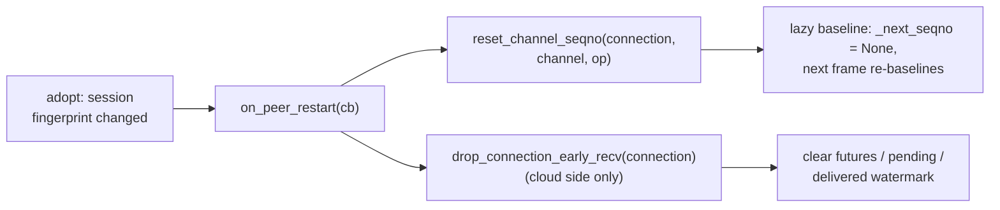

# LWD Peer-Restart Recovery and Dynamic Links

> Porting design for the peer-restart recovery line implemented on the old branch
> (`host_rdma_self_process`, workspace `C:\unify`) into this baseline. Source design
> docs: old-branch `lwd_动态建链实现整理.md` (base mechanisms) and
> `lwd_多实例动态建链修改整理.md` (multi-instance scenarios). This document restates
> both against THIS repo's architecture, vocabulary and team standards. Related:
> [lwd_host_data_plane.md](lwd_host_data_plane.md) (transport and failure model),
> [lwd_host_staging.md](lwd_host_staging.md) (cloud staging and early recv).

## 1. Problem: the current failure model is the bug class

`lwd_host_data_plane.md` states the failure model as *"there is no peer-restart
recovery: `on_peer_restart` is not wired and seqnos are not reset, so a restarted
peer means restarting the whole deployment."* The old branch's restart line exists
precisely to remove that clause. Two concrete hazards verified in this repo today:

| Hazard | Evidence | Failure shape |
| --- | --- | --- |
| Queue baseline pinned to 0 | `lwd_transfer_queue.py:90-91` sets `_next_seqno = 0` on the first frame and holds higher seqnos until the missing lower ones arrive | A restarted peer whose counter continued (or reset) against a survivor holding its own state makes the queue wait forever for seqnos that never come: the old branch's "infinite hang, zero errors" class (its fix `fd09dfdbe`) |
| Early-recv idempotence ledger survives an edge restart | `lwd_cloud_worker.py:249` `_early_recv_last_delivered`, consumed at `:480` | The new edge's from-zero hints are silently rejected as "already delivered": recv never posts, rows never report, the request hangs with zero errors (old branch pit #4) |

The same restart of a cloud leaves the edge side with zombie UCX endpoints: the
transport detects broken links only under traffic, so the first request after
recovery can sit in a dead endpoint for tens of seconds (the old branch measured
~63 s) even though the control plane already sees the peer back.

## 2. What this repo already has (the port is mostly consumption-side)

| Primitive | Location | Status |
| --- | --- | --- |
| UHC1 handshake session fingerprint (value change = peer restart, the only standard separating restart from network break) | `vllm/v1/lwd_comm/data_comm/ucx_channel.py:215` | Present; adopted links compare it |
| `on_peer_restart` callback API + honest "(fired)" logging | `ucx_channel.py:799`, `:1189` | Present; **no consumer** — `host/ucx_io.py:146` documents the deliberate U1 gap |
| Supervised reconnect with backoff (edge connects out, cloud re-adopts) | `ucx_io.py` header | Present |
| Full `ConnectionId(edge, cloud, dp)` on every request, queue and account key | `lwd_types.py`, `lwd_data_plane.py`, scheduler accounts | Present — the old branch's missing-dimension key pit is structurally solved; resets use exact keys, no `_dim_match` needed, but **MISS must log** |
| Registered-peer control plane + edge registration retry | `lwd_control_plane.py:204-278` (`_registered_peers`, `LwdPeerNotRegisteredError`), `LwdControlPlaneConfig.hello_retry_interval_s` | Concept present; no heartbeat accounts, no silent detection, no availability gate |
| ROUTER identity handover for same-identity reconnects | `v1/engine/core_client.py:601, :639` via `enable_input_socket_handover` | Still gated by `enable_elastic_ep` — the old branch's "final answer" (`d40f771c47`, unconditional) does not apply here yet |
| Multi-frontend attach runtime (old `frontend_attach.py`) | config validation only (`config/lwd/api.py`) | **No runtime counterpart** — see Phase 3 |

So the port splits cleanly: the transport primitives and detection exist; what is
missing is the consumption side (seqno baseline reset, ledger reset, restart-hook
registry), the control-plane liveness layer, and the frontend restart runtime.

## 3. Design

### 3.1 Identity and keys

The old branch's five-tuple `(edge, cloud, engine, channel, op)` maps to this repo's
`(ConnectionId(edge, cloud, dp), channel, op)` with `engine_index ≡ dp_idx`.
Requests here always carry a complete `ConnectionId` (built once in
`connection_from`), so the old "key backfill + dimension tolerance" work is not
needed; the rule that survives the port is the diagnostic one: **a reset that
finds no channel for its key is an error log, never a silent drop** (old branch
pit #3's lesson in its portable form).

### 3.2 Phase 1 — data plane recovery (embedded transport)

Scope: when a restarted peer's new link is adopted, the survivor side resyncs
itself. Detection is already delivered by the session fingerprint at adopt time.



1. **Callback registration**: `lwd_init_host_channels` registers one closure per
   built IO capturing its plain `(ConnectionId, channel, op)` — the same identity
   the queue keys use.
2. **Lazy baseline** (`lwd_transfer_queue.py`): the reset clears `_next_seqno` to
   `None` and drops the skip/held bookkeeping for that queue; the first frame
   after the reset becomes the new baseline. This removes the "reset to which
   value" question the old branch solved the same way, and fixes the pinned-to-0
   hazard of `:90-91`. In-flight futures are already failed by the link break
   itself (fail-fast, no replay).
3. **Ledger reset** (`lwd_cloud_worker`): a `drop_connection_early_recv` entry
   point clears the connection's early-recv state including
   `_early_recv_last_delivered`. Note `:407` already pops that key on one path —
   the port must verify that path's trigger actually covers peer restart before
   relying on it. The hook reaches the worker through a module-level singleton
   (old branch's `_ENDPOINT_WORKER` pattern; this repo has no such singleton yet).
4. **Restart-hook registry** (vllm repo): a small module under
   `vllm/v1/lwd_control/lwd_comm/` exposing
   `register_cloud_restart_hook(hook)` / `notify_cloud_restarted(cloud_id, dp_idx, reason)`
   — the same layering rule as the old branch (the vllm repo never imports
   vllm-ascend; the ascend side registers its teardown at wiring time). Reasons
   enumerate the detection source (`session fingerprint`, `heartbeat silent`,
   `boot_id changed`).
5. **Bounded submit wait** (old `VLLM_ASCEND_LWD_UCX_SUBMIT_WAIT_READY_S`, default
   5 s): submit waits for the reconnect window before failing. Per standard 7.9
   this becomes topology config, not an env: a
   `deployment.data_plane_host.submit_wait_ready_s` field (default 5). Extending
   the grandfathered `VLLM_ASCEND_LWD_UCX_*` env family instead needs review
   approval; the doc's choice is config.
6. **Boundary carried from the old branch**: in sidecar/daemon transport the
   peer-restart event does not cross the ctl/cpl protocol, so Phase 1 covers the
   embedded mode only; sidecar keeps the whole-deployment-restart semantics until
   the daemon protocol grows a "peer restarted" event.

Phase 1 without Phase 2 means **recovery happens when the peer returns** (new link
adopted, fingerprint differs); killing the zombie link *before* the peer returns
is Phase 2's linked teardown.

### 3.3 Phase 2 — control plane: liveness, failure containment and the availability gate

The old branch shipped liveness and failure containment as one loop with the
Phase 1 resets; this repo's current failure semantics escalate instead of
contain, so **Phase 2 starts with the containment half**, or Phase 1's resets
never get to matter under traffic:

1. **Edge side**: a failed transfer future today raises through the runner
   into a fatal EngineCore error (the frontend exits with it). Containment
   means per-request failure: the victim request finishes with
   `FinishReason.ERROR`, the engine keeps serving.
2. **Cloud side**: a link break today routes the early-recv error path into
   `abort_connection`'s permanent `_failed_connections` marking (no un-fail
   path exists). Containment means a transient drop for mere link errors —
   the Phase 1 reset then re-enables the connection when the peer returns.

The liveness layer then makes the containment window fast and observable:

The old branch plumbed heartbeat accounting into three ZMQ receive paths (one per
legacy form); this repo has a single ROUTER/DEALER control plane, so the port lands
on **one** receive path.

- The cloud control plane publishes a periodic HELLO (old default 1 s) carrying a
  `boot_id` epoch (random per process launch);
- The edge keeps per-`(cloud_id, dp_idx)` accounts — `hello_last`, `hello_boot`,
  a silent set with `frozenset` snapshots (single-writer on the receive thread,
  main thread reads snapshots — the old branch's concurrency shape);
- Silent beyond the threshold (new `LwdControlPlaneConfig.hello_silent_s`,
  default 10 s, floor 3 s) fires `notify_cloud_restarted(cloud_id, dp_idx,
  reason="heartbeat silent Ns")` → the registry → **linked teardown** of that
  cloud DP's data-plane links (force reconnect; in-flight ops fail fast), closing
  the "control plane recovered, data plane still zombie" window;
- `boot_id` change fires the same notification with that reason;
- **reannounce** is absorbed by this plane's periodic HELLO — verified the
  hard way: `_on_tick` originally stopped re-sending HELLO once the
  handshake completed, so a restarted cloud's ROUTER never saw the edge
  again (silent forever, permanent gate) even though `should_send_hello`
  documented "HELLO doubles as registration and the application
  heartbeat". The tick gate now honors that contract: HELLO flows every
  `hello_retry_interval_s` forever, and the cloud dedupes same-session
  retries (refresh + re-accept, `registered=False`).
- **Availability gate**: the edge engine's admission check rejects new requests
  with `FinishReason.ERROR` while every known route is silent (partial silence
  rejects only requests whose target group is silent). The gate releases on the
  next heartbeat. Rejection is a client-visible failure, retryable — not a hang.

Config lands in `LwdControlPlaneConfig` (`hello_interval_s`, `hello_silent_s`),
config-file-first per standard 7.9; the silent threshold doubles as both the
gate latency and the in-flight failure latency, so it must be reviewed against
`handshake_timeout_s`.

### 3.4 Phase 3 — frontend and primary-edge restart

Touches vllm core (`v1/engine/core_client.py`, `core.py`) and is the most
intrusive phase; it starts with an audit because the old `frontend_attach.py`
has no runtime counterpart here (only the CLI/config validation of
`config/lwd/api.py` exists).

1. **ROUTER handover unconditional**: this repo's `core_client.py` still gates
   `router_handover` on `enable_elastic_ep`; the old branch's final fix makes it
   unconditional — "it only takes effect on duplicate identity, zero impact on
   the normal path". Without it, a restarted primary edge's same-identity DEALER
   connects but is unaddressable behind the dead engine's identity table entry:
   requests evaporate silently.
2. **Attach runtime**: persistent registration server (barrier for startup,
   resident service for runtime), re-register watchdog, READY resend on DEALER
   socket-monitor reconnects, client-side engine revival. The old deterministic
   engine IO ports (`rpc_port+1000+2*idx`) are already structurally covered here:
   the primary's frontend endpoint is explicit `IP:port` config, so a restart
   rebinds the same address by construction and libzmq reconnects transparently.

### 3.5 Logging discipline (standard 7.12)

Event chains at error level, one line per event; steady-state probes at debug.
A restart drill must be readable by `grep ERROR` as a complete causal chain, in
this repo's component names:

```text
cloud restart (edge side):
  [LWD] cloud 0 dp 0 silent 10s (no HELLO)            <- liveness verdict
  [LWD] cloud 0 dp 0 RESTARTED (boot_id ... -> ...)   <- epoch verdict
  [LWD] cloud restart: force reconnect ...            <- linked teardown
  [ucx-chan] ... broken (reconnecting)                  <- link teardown
  [ucx-chan] ... up gen=N PEER-RESTARTED               <- adopt + fingerprint
  [LWD] reset_channel_seqno connection=...             <- queue baseline
edge restart (cloud side):
  [ucx-chan] ... up gen=N PEER-RESTARTED
  [LWD] reset_channel_seqno connection=...
  [LWD][pre-recv] early-recv ledger dropped connection=...
```

## 4. Code map (old branch → this repo)

| Old (`host_rdma_self_process`) | This repo |
| --- | --- |
| `vllm/v1/lwd_comm/__init__.py` restart-hook registry | new `vllm/v1/lwd_control/lwd_comm/` registry module (same layering: vllm never imports vllm-ascend) |
| `lwd_comm/service.py` `reset_channel_seqno` + `_dim_match` | `LwdDataPlane.reset_channel_seqno` — exact `ConnectionId` keys, MISS error-logged |
| `lwd_comm/channel.py` lazy baseline | `lwd_transfer_queue.py` `_next_seqno` None-baseline + held/skip reset |
| `ucx_npu_channel.py` `on_peer_restart` wiring, bounded submit wait | `host/ucx_io.py` + `host/lwd_host_channels.py` registration; wait window from `data_plane_host` config |
| `lwd_wire_host.py` hooks, `_ENDPOINT_WORKER` singleton | `host/lwd_host_channels.py` wiring + a cloud-worker singleton/registry |
| worker request key backfill (`edge_id`/`cloud_id`) | not needed — `ConnectionId` is complete everywhere |
| three-path heartbeat accounting + availability gate | single-path accounts on `LwdControlPlane` + gate in the edge engine |
| `reannounce` re-handshake | absorbed by registration retry (verify; else silent-triggered re-register) |
| `frontend_attach.py` persistent registration + watchdog + READY resend | no counterpart yet — Phase 3 builds it in this repo's terms |
| `core_client.py` ROUTER_HANDOVER unconditional, engine revival | `v1/engine/core_client.py` near 1:1 |
| envs `HELLO_INTERVAL_S` / `HELLO_SILENT_S` / `UCX_SUBMIT_WAIT_READY_S` | `LwdControlPlaneConfig` / `deployment.data_plane_host` fields (standard 7.9) |

Vocabulary (one concept, one word — standard 7.5): `on_peer_restart` and
`force reconnect` keep their transport names; `silent` and `lazy baseline` are
introduced once each; the old `reannounce` is retired in favor of
"re-register" if it survives verification at all.

## 5. Phasing and acceptance

| Phase | Content | Acceptance |
| --- | --- | --- |
| 1 | Data-plane consumption side (§3.2) + registry skeleton | Unit tests in full; **idle-window drills**: kill the peer with zero in-flight traffic, restart it, new requests must flow with the error chains below and the survivor process NOT restarting |
| 2 | Failure containment + control-plane liveness, linked teardown, gate (§3.3) | Traffic-window drills: survivor keeps serving through the outage, victim requests fail within the bounded window (no ~63 s zombie hang), gate admits/rejects/releases |
| 3 | ROUTER handover + attach runtime (§3.4) | Primary-edge restart drill: attach frontend re-registers, engine revives, requests survive |

The Phase 1 acceptance is deliberately narrow: the survivor's failure
handling is fatal today (an edge transfer failure kills the engine; a cloud
link break permanently fails the connection — §3.3 items 1-2), so any drill
with in-flight traffic at the break degenerates into a full-stack restart
rather than validating the resets. Idle-window drills verify the Phase 1
mechanics (wiring, lazy baseline, ledger drop); the traffic-window behavior
arrives with Phase 2.

Each phase's failure branches are unit-testable without NPU (queue baseline
reset, ledger drop, MISS logging, gate admit/reject/silent-release); the drills
above are the runbook on the machines. `lwd_host_data_plane.md`'s failure-model
clause flips from "no peer-restart recovery" to this design **in the same commit**
as Phase 1 (standards: a replacement is done in one step, docs ride with it).

## 6. Boundaries carried from the old branch

- Sidecar/daemon transport: peer-restart events do not cross the ctl/cpl
  protocol; Phase 1 covers embedded mode, sidecar keeps whole-deployment-restart
  semantics until the daemon protocol grows the event.
- Pre-posted cloud recvs have no withdrawal path; after a teardown they degrade
  to warning noise until an abort linkage exists.
- Hint-before-adopt race: a new edge's RangeNotify may beat the adopt/ledger
  reset; the detection criterion is "no `ledger dropped` line on the failure" —
  if it shows, harden with an epoch re-check at hint rejection.
- The silent threshold sets both the gate latency and the in-flight failure
  latency; align it with `handshake_timeout_s` during review.

## 7. Process (team standards)

- Two-repo footprint far exceeds 500 LOC → an RFC issue is required; this
  document is its design basis.
- Config-file-first for every new knob (§3.2/§3.3); the grandfathered
  `VLLM_ASCEND_LWD_UCX_*` env family is not extended without review.
- Every MISS/drop path logs (fail-fast, no silent state loss); `[LWD]` prefix,
  event chains at error, steady probes at debug.
- Unit tests for the business logic of each phase, failure branches included;
  AI-written test lists go to the reviewer.
- vllm and vllm-ascend PRs cross-link; design doc + failure-model flip ride with
  the phase that implements them.

### 7.1 Porting lessons (grows with each incident)

1. **A periodic mechanism is only as alive as its host thread.** The old
   branch's heartbeat lived on always-running pump/publisher threads; this
   repo's control plane binds the sender to the engine thread and has no
   resident business pump. Porting "send a beat every second" onto the
   engine STEP loop made the heartbeat blind while the engine idles: a
   healthy idle deployment read as dead on the first request, and the
   linked teardown destroyed its delivery. The correct host is the
   input-queue WAKEUP primitive (the heartbeat thread ticks the queue,
   the engine thread sends — owner-thread contract intact). Rule: before
   porting any periodic/background behavior, answer WHERE it runs when the
   system is idle.
2. **Dynamic-link features must not touch the healthy path.** Every
   recovery-side addition was audited for normal-path reachability
   (exception-only, registration-only, or negligible-cost items pass);
   the one item that reached into the default scenario — the step-loop
   heartbeat — is exactly the one that broke it. Unit tests passed
   because each mechanism was correct in isolation; the failing scenario
   was the INTERACTION (idle bring-up × first request). Regression tests
   must encode the default scenario shape, not just the mechanism.
3. **An old-branch reference is only as good as the INVARIANTS extracted
   from it.** All three machine incidents had full references in the old
   branch's code and docs — and all three still happened, because the
   behavior was ported while the invariant it rested on was not: the
   heartbeat's host must run while idle (old pumps never slept; the
   step-loop host does), a gated request must finish exactly once (the
   old gate finished directly; the abort-channel rebuild double-added),
   and a re-handshake must actually re-run after a peer restart (the
   old `reannounce` existed precisely because "transport reconnect does
   not re-run the handshake" — the new plane's tick gate defeated its
   own documented intent). Rule: before adapting any old-branch
   mechanism, translate its defect→fix table into an explicit invariant
   list (host liveness, exactly-once settlement, must-reach-after-
   trigger) and treat those invariants as the acceptance conditions of
   the new implementation.
