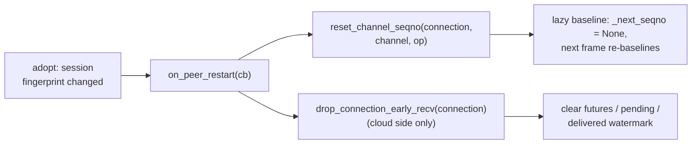

# LWD Peer-Restart Recovery and Dynamic Links

> Porting design for the peer-restart recovery line implemented on the old branch
> (`host_rdma_self_process`, workspace `C:\unify`) into this baseline. Source design
> and defect-to-fix tables live there; the committed file-by-file inventory of this
> port lives in `lwd_porting_change_inventory.md`.
> docs: old-branch `lwd_动态建链实现整理.md` (base mechanisms) and
> `lwd_多实例动态建链修改整理.md` (multi-instance scenarios). This document restates
> both against THIS repo's architecture, vocabulary and team standards. Related:
> [lwd_host_data_plane.md](lwd_host_data_plane.md) (transport and failure model),
> [lwd_host_staging.md](lwd_host_staging.md) (cloud staging and early recv).

## 1. Problem: the current failure model is the bug class

`lwd_host_data_plane.md` states the failure model as *"there is no peer-restart
recovery: `on_peer_restart` is not wired and seqnos are not reset, so a restarted
peer means restarting the whole deployment."* The old branch's restart line exists
precisely to remove that clause. Two concrete hazards verified in this repo today:

| Hazard | Evidence | Failure shape |
| --- | --- | --- |
| Queue baseline pinned to 0 | `lwd_transfer_queue.py:90-91` sets `_next_seqno = 0` on the first frame and holds higher seqnos until the missing lower ones arrive | A restarted peer whose counter continued (or reset) against a survivor holding its own state makes the queue wait forever for seqnos that never come: the old branch's "infinite hang, zero errors" class (its fix `fd09dfdbe`) |
| Early-recv idempotence ledger survives an edge restart | `lwd_cloud_worker.py:249` `_early_recv_last_delivered`, consumed at `:480` | The new edge's from-zero hints are silently rejected as "already delivered": recv never posts, rows never report, the request hangs with zero errors (old branch pit #4) |

The same restart of a cloud leaves the edge side with zombie UCX endpoints: the
transport detects broken links only under traffic, so the first request after
recovery can sit in a dead endpoint for tens of seconds (the old branch measured
~63 s) even though the control plane already sees the peer back.

## 2. What this repo already has (the port is mostly consumption-side)

| Primitive | Location | Status |
| --- | --- | --- |
| UHC1 handshake session fingerprint (value change = peer restart, the only standard separating restart from network break) | `vllm/v1/lwd_comm/data_comm/ucx_channel.py:215` | Present; adopted links compare it |
| `on_peer_restart` callback API + honest "(fired)" logging | `ucx_channel.py:799`, `:1189` | Present; **no consumer** — `host/ucx_io.py:146` documents the deliberate U1 gap |
| Supervised reconnect with backoff (edge connects out, cloud re-adopts) | `ucx_io.py` header | Present |
| Full `ConnectionId(edge, cloud, dp)` on every request, queue and account key | `lwd_types.py`, `lwd_data_plane.py`, scheduler accounts | Present — the old branch's missing-dimension key pit is structurally solved; resets use exact keys, no `_dim_match` needed, but **MISS must log** |
| Registered-peer control plane + edge registration retry | `lwd_control_plane.py:204-278` (`_registered_peers`, `LwdPeerNotRegisteredError`), `LwdControlPlaneConfig.hello_retry_interval_s` | Concept present; no heartbeat accounts, no silent detection, no availability gate |
| ROUTER identity handover for same-identity reconnects | `v1/engine/core_client.py:601, :639` via `enable_input_socket_handover` | Still gated by `enable_elastic_ep` — the old branch's "final answer" (`d40f771c47`, unconditional) does not apply here yet |
| Multi-frontend attach runtime (old `frontend_attach.py`) | config validation only (`config/lwd/api.py`) | **No runtime counterpart** — see Phase 3 |

So the port splits cleanly: the transport primitives and detection exist; what is
missing is the consumption side (seqno baseline reset, ledger reset, restart-hook
registry), the control-plane liveness layer, and the frontend restart runtime.

## 3. Design

### 3.1 Identity and keys

The old branch's five-tuple `(edge, cloud, engine, channel, op)` maps to this repo's
`(ConnectionId(edge, cloud, dp), channel, op)` with `engine_index ≡ dp_idx`.
Requests here always carry a complete `ConnectionId` (built once in
`connection_from`), so the old "key backfill + dimension tolerance" work is not
needed; the rule that survives the port is the diagnostic one: **a reset that
finds no channel for its key is an error log, never a silent drop** (old branch
pit #3's lesson in its portable form).

### 3.2 Phase 1 — data plane recovery (embedded transport)

Scope: when a restarted peer's new link is adopted, the survivor side resyncs
itself. Detection is already delivered by the session fingerprint at adopt time.



1. **Callback registration**: `lwd_init_host_channels` registers one closure per
   built IO capturing its plain `(ConnectionId, channel, op)` — the same identity
   the queue keys use.
2. **Lazy baseline** (`lwd_transfer_queue.py`): the reset clears `_next_seqno` to
   `None` and drops the skip/held bookkeeping for that queue; the first frame
   after the reset becomes the new baseline. This removes the "reset to which
   value" question the old branch solved the same way, and fixes the pinned-to-0
   hazard of `:90-91`. In-flight futures are already failed by the link break
   itself (fail-fast, no replay).
3. **Ledger reset** (`lwd_cloud_worker`): a `drop_connection_early_recv` entry
   point clears the connection's early-recv state including
   `_early_recv_last_delivered`. Note `:407` already pops that key on one path —
   the port must verify that path's trigger actually covers peer restart before
   relying on it. The hook reaches the worker through a module-level singleton
   (old branch's `_ENDPOINT_WORKER` pattern; this repo has no such singleton yet).
4. **Restart-hook registry** (vllm repo): a small module under
   `vllm/v1/lwd_control/lwd_comm/` exposing
   `register_cloud_restart_hook(hook)` / `notify_cloud_restarted(cloud_id, dp_idx, reason)`
   — the same layering rule as the old branch (the vllm repo never imports
   vllm-ascend; the ascend side registers its teardown at wiring time). Reasons
   enumerate the detection source (`session fingerprint`, `no cloud activity`,
   `boot_id changed`).
5. **Bounded submit wait** (old `VLLM_ASCEND_LWD_UCX_SUBMIT_WAIT_READY_S`, default
   5 s): submit waits for the reconnect window before failing. This is a code
   constant, `LWD_SUBMIT_WAIT_READY_S` at its use site (the host channel
   wiring, `lwd_host_channels.py`), not an env and not yaml — the single
   wiring feeds both peers, so the value is identical on both by
   construction.
6. **Boundary carried from the old branch**: in sidecar/daemon transport the
   peer-restart event does not cross the ctl/cpl protocol, so Phase 1 covers the
   embedded mode only; sidecar keeps the whole-deployment-restart semantics until
   the daemon protocol grows a "peer restarted" event.

Phase 1 without Phase 2 means **recovery happens when the peer returns** (new link
adopted, fingerprint differs); killing the zombie link *before* the peer returns
is Phase 2's linked teardown.

### 3.3 Phase 2 — control plane: liveness, failure containment and the availability gate

The old branch shipped liveness and failure containment as one loop with the
Phase 1 resets; this repo's current failure semantics escalate instead of
contain, so **Phase 2 starts with the containment half**, or Phase 1's resets
never get to matter under traffic:

1. **Edge side**: a failed transfer future today raises through the runner
   into a fatal EngineCore error (the frontend exits with it). Containment
   means per-request failure: the victim request finishes with
   `FinishReason.ERROR`, the engine keeps serving.
2. **Cloud side**: a link break today routes the early-recv error path into
   `abort_connection`'s permanent `_failed_connections` marking (no un-fail
   path exists). Containment means a transient drop for mere link errors —
   the Phase 1 reset then re-enables the connection when the peer returns.

The liveness layer then makes the containment window fast and observable:

The old branch plumbed heartbeat accounting into three ZMQ receive paths (one per
legacy form); this repo has a single ROUTER/DEALER control plane, so the port lands
on **one** receive path.

- The cloud control plane publishes a periodic HELLO (old default 1 s) carrying a
  `boot_id` epoch (random per process launch);
- The edge keeps per-connection accounts — `hello_last`, a separate
  `business_last` (any valid cloud-to-edge request frame), `hello_boot`, a silent
  set with `frozenset` snapshots — in an independent `LwdHeartbeatMonitor`
  (`control_edge_scheduler/lwd_heartbeat.py`), not in the engine. It owns the
  detection, emits one immutable `LwdHeartbeatVerdict` at a single event exit
  point, and fires the teardown; consumers only subscribe or read its
  read-only query surface (`is_alive`, `silent_routes`, `silent_clouds`,
  `boot_id`, `last_activity`). The judge reads
  `max(hello_last, business_last)`: a heartbeat frame stuck behind a busy
  outbound FIFO, or a cloud engine thread busy with a long step, no longer
  makes a cloud that is still answering requests look dead. Boot-id tracking
  stays heartbeat-only, since business frames carry no epoch;
- Silent beyond the threshold (code constant `LWD_HELLO_SILENT_S`, 10 s) on
  BOTH channels fires `notify_cloud_restarted(cloud_id, dp_idx,
  reason="no cloud activity Ns")` → the registry → **linked teardown** of that
  cloud DP's data-plane links (force reconnect; in-flight ops fail fast), closing
  the "control plane recovered, data plane still zombie" window;
- `boot_id` change fires the same notification with that reason;
- **reannounce** is absorbed by this plane's periodic HELLO — verified the
  hard way: `_on_tick` originally stopped re-sending HELLO once the
  handshake completed, so a restarted cloud's ROUTER never saw the edge
  again (silent forever, permanent gate) even though `should_send_hello`
  documented "HELLO doubles as registration and the application
  heartbeat". The tick gate now honors that contract: HELLO flows every
  `hello_retry_interval_s` forever, and the cloud dedupes same-session
  retries (refresh + re-accept, `registered=False`).
- **Availability gate**: the edge engine's admission check rejects new requests
  with `FinishReason.ERROR` while every known route is silent (partial silence
  rejects only requests whose target group is silent). It reads the monitor's
  `silent_routes()` (frozen verdict unioned with a live staleness view), so a
  cloud that went quiet while the engine idled cannot admit the request that
  wakes it. The gate releases on the next heartbeat or business frame.
  Rejection is a client-visible failure, retryable — not a hang.
- **Single event exit**: the monitor publishes its verdict to subscribers —

  `scheduler.lwd_update_silent_routes` and the probe manager (which forwards
  to `LwdCloudHealthTracker`). The tracker only caches the verdict; it never
  runs detection. There is no second liveness set pushed by hand at the two
  transitions. The hard availability decision (gate / routing / teardown)
  stays out of the tracker, whose fail-open belongs to probe targeting only.

The heartbeat cadence and the silent threshold are code constants at
their use sites — `LWD_HELLO_INTERVAL_S` in the cloud engine,
`LWD_HELLO_SILENT_S` in the edge engine. They are the two halves of one
liveness contract (the sender's pace and the judge's threshold); each
constant's comment names the other's file, so a change to either
considers both; the silent threshold doubles as both the
gate latency and the in-flight failure latency, so it must be reviewed against
`handshake_timeout_s`.

### 3.4 Phase 3 — frontend and primary-edge restart

Implemented by INHERITANCE so vllm's native `v1/engine/core.py` and
`core_client.py` stay pristine: the engine input-thread override lives on
`LwdBaseEngineCore` (`control_scheduler/lwd_base_engine.py` — the thread
target is self-bound, so the subclass method runs), and the frontend
client is `LwdAsyncMPClient` (`entrypoints/openai/lwd/lwd_async_client.py`)
with its factory routing applied from the ascend platform's config pass
(frontend workers import no LWD module of their own; the wrapper
delegates to the native factory for non-LWD and DP>1). The phase started
with an audit because the old `frontend_attach.py` has no runtime
counterpart here (only the CLI/config validation of `config/lwd/api.py`
exists).

1. **ROUTER handover unconditional**: the client's input ROUTER enables
   `ROUTER_HANDOVER` unconditionally — "it only takes effect on duplicate
   identity, zero impact on the normal path". Without it, a restarted
   primary edge's same-identity DEALER connects but is unaddressable
   behind the dead engine's identity table entry: requests evaporate
   silently. Set post-bind on the LWD client.
2. **Attach runtime**: persistent registration server (barrier for startup,
   resident service for runtime), re-register watchdog, READY resend on DEALER
   socket-monitor reconnects, client-side engine revival. The deterministic
   engine IO ports come from the topology yaml: `deployment.api_bind_base_port`
   (edge_share-only field, default 61000) — attach frontend `idx` binds
   `base + 2*idx` (input ROUTER) and `+1` (output PULL), and the whole
   16-port band `[base, base+2*8-1]` is reserved for up to
   `LWD_API_MAX_FRONTENDS = 8` frontends. The capacity cap is enforced at
   port-occupation time — the `engine_io_addresses` derivation raises for
   an index without a reserved pair, and the bind side, the primary's
   pre-seed and the registration authority all derive through it — not at
   config time: the yaml may describe larger plans. The field itself is
   rejected outright for other scenes. A restart rebinds
   the same address by construction and libzmq reconnects transparently.
   Bidirectional conflict checks keep deployment ports out of the band: the
   attach command and the primary each verify their own configured ports
   (HTTP listen, registration, master/rpc) at startup, and the authority
   rejects any registration whose HTTP listen port falls inside the band.

   The engine-revival contract, as implemented in `LwdAsyncMPClient`: the output
   reader survives the old engine's `ENGINE_CORE_DEAD` broadcast (an exited
   reader means every later output is unread and requests hang with no error),
   and the dead flag clears on either of two complementary criteria — a normal
   output frame (the replacement engine already produced output), or the READY
   re-send buffered on the input ROUTER, probed from the send path when the
   dead marker intercepts a request. During the dead window new requests fail
   fast at the AsyncLLM admission gate (`errored` reads the same flag) —
   inherited old-branch behavior; the gate reopens once either criterion fires.
   The batch also carries the old branch's drill-log chain and its input-thread
   death containment: engine input address self-certification, DEALER
   connect/disconnect/retry events, a frontend-side ROUTER accept monitor, and
   rate-limited message-path probes (debug) pairing with the engine's for the
   three-hop proof (client sent → engine received → output received). An input
   thread that dies escalates as a visible engine failure instead of leaving
   every frontend hanging silently.
3. **Elastic partial start**: the yaml may plan more frontends than are
   launched. The startup barrier became a grace window (default 60 s,
   normally hidden under the engine's model load, which overlaps the
   barrier): the primary proceeds with the registered subset, and the
   engine's frontend list is pre-seeded with the deterministic attach
   addresses (`engine_io_addresses` — the same derivation the attach
   command binds, single source for both sides), so a frontend that
   starts later binds the same address and joins through the transparent
   DEALER/PUSH reconnection (the READY re-send completes its client
   handshake). A registration inside the window upgrades its slot to the
   actual endpoints. Boundary: the seed derives the host from this host's
   route toward the registration endpoint — exact for the same-host
   edge_share deployment (one engine host, N API frontends); a cross-host
   attach frontend must register inside the grace window.

   The same partial-start semantics cover the CLOUD dimension (the yaml
   plans N clouds, fewer are launched): the edge's data-plane warm-up and
   control-plane barrier give the first link/accept the long window (a
   co-started cloud binds its listener only partway into its own init)
   and the remainder a 60 s straggler grace, then proceed with the
   connected/accepted subset; zero accepts is still a startup failure.
   A cloud that starts later reconnects through its supervision thread,
   its handshake keeps being retried by the periodic HELLO, and its
   scheduling limits adopt it into the running edge (validated limits,
   sendable peer, liveness seed, probe hash sizes — the same
   `_lwd_adopt_cloud` routine the init path uses). Until adoption, the
   availability gate rejects the requesting frontend's requests with
   "no adopted connection" (fast, retryable, the same client-visible
   shape as the silent-route rejection), a post-route check cancels any
   admission that still scored an un-adopted connection, and the send
   path drops with a log instead of crashing the shared engine.

### 3.5 Logging discipline (standard 7.12)

Event chains at error level, one line per event; steady-state probes at debug.
A restart drill must be readable by `grep ERROR` as a complete causal chain, in
this repo's component names:

```text
cloud restart (edge side):
  [LWD] cloud 0 dp 0 silent 10s (no HELLO)            <- liveness verdict
  [LWD] cloud 0 dp 0 RESTARTED (boot_id ... -> ...)   <- epoch verdict
  [LWD] cloud restart: force reconnect ...            <- linked teardown
  [ucx-chan] ... broken (reconnecting)                  <- link teardown
  [ucx-chan] ... up gen=N PEER-RESTARTED               <- adopt + fingerprint
  [LWD] reset_channel_seqno connection=...             <- queue baseline
edge restart (cloud side):
  [ucx-chan] ... up gen=N PEER-RESTARTED
  [LWD] reset_channel_seqno connection=...
  [LWD][pre-recv] early-recv ledger dropped connection=...
```

## 4. Code map (old branch → this repo)

| Old (`host_rdma_self_process`) | This repo |
| --- | --- |
| `vllm/v1/lwd_comm/__init__.py` restart-hook registry | new `vllm/v1/lwd_control/lwd_comm/` registry module (same layering: vllm never imports vllm-ascend) |
| `lwd_comm/service.py` `reset_channel_seqno` + `_dim_match` | `LwdDataPlane.reset_channel_seqno` — exact `ConnectionId` keys, MISS error-logged |
| `lwd_comm/channel.py` lazy baseline | `lwd_transfer_queue.py` `_next_seqno` None-baseline + held/skip reset |
| `ucx_npu_channel.py` `on_peer_restart` wiring, bounded submit wait | `host/ucx_io.py` + `host/lwd_host_channels.py` registration; wait window from `data_plane_host` config |
| `lwd_wire_host.py` hooks, `_ENDPOINT_WORKER` singleton | `host/lwd_host_channels.py` wiring + a cloud-worker singleton/registry |
| worker request key backfill (`edge_id`/`cloud_id`) | not needed — `ConnectionId` is complete everywhere |
| three-path heartbeat accounting + availability gate | single-path accounts on `LwdControlPlane` + gate in the edge engine |
| `reannounce` re-handshake | absorbed by registration retry (verify; else silent-triggered re-register) |
| `frontend_attach.py` persistent registration + watchdog + READY resend | no counterpart yet — Phase 3 builds it in this repo's terms |
| `core_client.py` ROUTER_HANDOVER unconditional, engine revival | `LwdAsyncMPClient` (`entrypoints/openai/lwd/lwd_async_client.py`) + ascend-platform factory routing; native `core_client.py` untouched |
| `core.py` READY resend + input-thread containment | `LwdBaseEngineCore.process_input_sockets` override (`control_scheduler/lwd_base_engine.py`); native `core.py` untouched |
| envs `HELLO_INTERVAL_S` / `HELLO_SILENT_S` / `UCX_SUBMIT_WAIT_READY_S` | code constants `LWD_HELLO_INTERVAL_S` / `LWD_HELLO_SILENT_S` / `LWD_SUBMIT_WAIT_READY_S` at their use sites (cloud engine / edge engine / host channel wiring) |

Vocabulary (one concept, one word — standard 7.5): `on_peer_restart` and
`force reconnect` keep their transport names; `silent` and `lazy baseline` are
introduced once each; the old `reannounce` is retired in favor of
"re-register" if it survives verification at all.

## 5. Phasing and acceptance

| Phase | Content | Acceptance |
| --- | --- | --- |
| 1 | Data-plane consumption side (§3.2) + registry skeleton | Unit tests in full; **idle-window drills**: kill the peer with zero in-flight traffic, restart it, new requests must flow with the error chains below and the survivor process NOT restarting |
| 2 | Failure containment + control-plane liveness, linked teardown, gate (§3.3) | Traffic-window drills: survivor keeps serving through the outage, victim requests fail within the bounded window (no ~63 s zombie hang), gate admits/rejects/releases |
| 3 | ROUTER handover + attach runtime (§3.4) | Primary-edge restart drill: attach frontend re-registers, engine revives, requests survive; partial-start drills: yaml plans N, launch edge 0 + cloud 0 only → instance 0 serves alone; launch the attach frontend later → it serves without a primary restart; start cloud 1 later → its connection is adopted while the edge keeps serving |

The Phase 1 acceptance is deliberately narrow: the survivor's failure
handling is fatal today (an edge transfer failure kills the engine; a cloud
link break permanently fails the connection — §3.3 items 1-2), so any drill
with in-flight traffic at the break degenerates into a full-stack restart
rather than validating the resets. Idle-window drills verify the Phase 1
mechanics (wiring, lazy baseline, ledger drop); the traffic-window behavior
arrives with Phase 2.

Each phase's failure branches are unit-testable without NPU (queue baseline
reset, ledger drop, MISS logging, gate admit/reject/silent-release); the drills
above are the runbook on the machines. `lwd_host_data_plane.md`'s failure-model
clause flips from "no peer-restart recovery" to this design **in the same commit**
as Phase 1 (standards: a replacement is done in one step, docs ride with it).

## 6. Boundaries carried from the old branch

- Sidecar/daemon transport: peer-restart events do not cross the ctl/cpl
  protocol; Phase 1 covers embedded mode, sidecar keeps whole-deployment-restart
  semantics until the daemon protocol grows the event.
- Pre-posted cloud recvs have no withdrawal path; after a teardown they degrade
  to warning noise until an abort linkage exists.
- Hint-before-adopt race: a new edge's RangeNotify may beat the adopt/ledger
  reset; the detection criterion is "no `ledger dropped` line on the failure" —
  if it shows, harden with an epoch re-check at hint rejection.
- The silent threshold sets both the gate latency and the in-flight failure
  latency; align it with `handshake_timeout_s` during review.

## 7. Process (team standards)

- Two-repo footprint far exceeds 500 LOC → an RFC issue is required; this
  document is its design basis.
- Config-file-first for every new knob (§3.2/§3.3); the grandfathered
  `VLLM_ASCEND_LWD_UCX_*` env family is not extended without review.
- Every MISS/drop path logs (fail-fast, no silent state loss); `[LWD]` prefix,
  event chains at error, steady probes at debug.
- Unit tests for the business logic of each phase, failure branches included;
  AI-written test lists go to the reviewer.
- vllm and vllm-ascend PRs cross-link; design doc + failure-model flip ride with
  the phase that implements them.

### 7.1 Porting lessons (grows with each incident)

1. **A periodic mechanism is only as alive as its host thread.** The old
   branch's heartbeat lived on always-running pump/publisher threads; this
   repo's control plane binds the sender to the engine thread and has no
   resident business pump. Porting "send a beat every second" onto the
   engine STEP loop made the heartbeat blind while the engine idles: a
   healthy idle deployment read as dead on the first request, and the
   linked teardown destroyed its delivery. The correct host is the
   input-queue WAKEUP primitive (the heartbeat thread ticks the queue,
   the engine thread sends — owner-thread contract intact). Rule: before
   porting any periodic/background behavior, answer WHERE it runs when the
   system is idle.
2. **Dynamic-link features must not touch the healthy path.** Every
   recovery-side addition was audited for normal-path reachability
   (exception-only, registration-only, or negligible-cost items pass);
   the one item that reached into the default scenario — the step-loop
   heartbeat — is exactly the one that broke it. Unit tests passed
   because each mechanism was correct in isolation; the failing scenario
   was the INTERACTION (idle bring-up × first request). Regression tests
   must encode the default scenario shape, not just the mechanism.
3. **An old-branch reference is only as good as the INVARIANTS extracted
   from it.** All three machine incidents had full references in the old
   branch's code and docs — and all three still happened, because the
   behavior was ported while the invariant it rested on was not: the
   heartbeat's host must run while idle (old pumps never slept; the
   step-loop host does), a gated request must finish exactly once (the
   old gate finished directly; the abort-channel rebuild double-added),
   and a re-handshake must actually re-run after a peer restart (the
   old `reannounce` existed precisely because "transport reconnect does
   not re-run the handshake" — the new plane's tick gate defeated its
   own documented intent). Rule: before adapting any old-branch
   mechanism, translate its defect→fix table into an explicit invariant
   list (host liveness, exactly-once settlement, must-reach-after-
   trigger) and treat those invariants as the acceptance conditions of
   the new implementation.
4. **The porting unit is the scenario row, not the mechanism batch.** The
   old branch's defect→fix table groups fixes by restart scenario, each row
   a complete recovery chain. Porting those rows as "technical tranches"
   broke the grouping twice: the persistent-registration fix arrived as
   half a pair (`serve_background` without the `attach_scope`
   nullcontext — the with-block still closed the server), and READY
   resend was scheduled as primary-restart work although the old table
   assigns it to the frontend-restart row (a restarted frontend's fresh
   `MPClient` waits for it). Both surfaced as machine incidents before
   their scheduled tranche even started. Rule: port scenario row by
   scenario row, close a row only when its drill passes end to end, and
   move pairs listed together in the reference together in the port.
